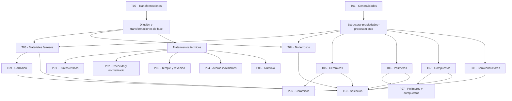

# Mapa de conexiones de la asignatura

El diagrama muestra relaciones principales entre los bloques. Es una vista conceptual, no una secuencia rígida de prerrequisitos.

## Cómo leerlo

- **Tema 01** introduce el marco estructura–propiedades–procesamiento que reaparece en toda la asignatura.
- **Tema 02** explica la evolución de fases y microestructuras, con conexión directa con los tratamientos térmicos.
- **Temas 03 y 04** aplican estos principios a aleaciones ferrosas y no ferrosas.
- **Temas 05, 06, 07 y 08** amplían el estudio a cerámicos, polímeros, compuestos y semiconductores.
- **Tema 09** analiza la degradación y **Tema 10** integra los criterios de selección.

Para profundizar, abrir el grafo local desde la nota de cada tema.
